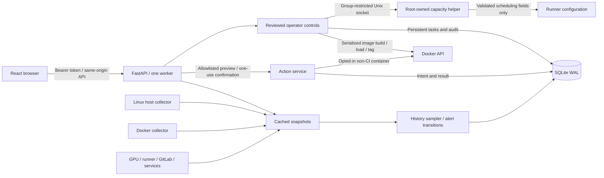

# Architecture and access boundaries

Collectors poll independently in background tasks, with blocking reads in worker threads. API reads return cached snapshots; opening more dashboards does not spawn more collectors. Slow GitLab requests cannot block host polling.

## Repository map

| Path | Responsibility |
|---|---|
| `backend/main.py` | API, authentication, collector scheduling, history and alert events |
| `backend/collectors.py` | Host, Docker, GPU, GitLab, runner, and systemd reads |
| `backend/findings.py` | Validated private survey archives and independent current checks |
| `backend/config.py`, `backend/run.py` | Environment settings and one-worker launcher |
| `backend/store.py` | SQLite samples, averaged history buckets, audit events |
| `backend/actions.py` | Ownership validation, previews, expiry, replay protection, execution |
| `backend/operations.py` | Runner-control client, bounded uploads, operation previews and serialized local image tasks |
| `frontend/src/app/` | Dashboard entry point, page wiring, and application styles |
| `frontend/src/features/runners/`, `frontend/src/lib/` | Runner/survey views, API client, formatting helpers |
| `deploy/` | Stable Python initialization, backup, import/export, and verification commands |
| `deploy/native/`, `deploy/offline/` | Native service assets and offline distribution builder |
| `scripts/runner/` | Administrator runner configuration and host tuning |
| `tests/backend/`, `tests/operations/` | Runtime checks and operational/deployment checks |
| `docs/` | User and operator handbook |
| `.tmp/` | Ignored local screenshots, browser artifacts, and backups |
| `deploy/docker/` | Runtime Dockerfile and explicit Compose deployment modes |

See [Repository layout](repository-layout.md) for the directory hierarchy and command-path conventions.

## HTTP surface

| Method / route | Authentication | Purpose |
|---|---|---|
| `GET /healthz` | None | Minimal liveness |
| `GET /api/snapshot` | Bearer | Sources, freshness, alerts, recommendations |
| `GET /api/history?hours=1` | Bearer | At most 600 averaged buckets, with peaks |
| `GET /api/events` | Bearer | Newest 100 events |
| `GET /api/metrics` | Bearer | Prometheus gauges |
| `POST /api/actions/preview` | Bearer | Validated 60-second action plan |
| `POST /api/actions/execute` | Bearer | One-use confirmed stop/restart |
| `GET /api/operations/capabilities` | Bearer | Operator enablement, capacity helper state, build profiles, completed uploads |
| `GET /api/operations/jobs` | Bearer | Latest 50 persistent image operation results |
| `POST /api/operations/preview` | Bearer | Reviewed capacity or local-image operation |
| `POST /api/operations/execute` | Bearer | One-use execution; image work is queued |
| `POST /api/operations/uploads?kind=image&name=file.tar` | Bearer | Bounded streaming archive upload; kind can also be context |
| `POST /api/operations/uploads/{id}/discard` | Bearer | Remove an unused staged upload |

The browser and API share an origin in production. Responses include content security, no-frame, no-sniff, and referrer headers; API responses are not cached. Authentication failures are rate limited. The application uses one operator credential, not individual identities or RBAC.

## Permissions

GitLab is read-only. Credentials stay in server configuration and are removed from exported integration error messages. Runner facts pass an allowlist before exposure. Process arguments/environments, Docker environment variables, and raw container logs are not collected.

Actions require the managed label and current container identity. Runner-named containers, GitLab-labeled jobs, and OpsDeck itself are excluded. These checks protect against operator mistakes; users who already control the Docker socket can alter labels and have extensive host control. A socket mount marked read-only still permits API requests.

Operator controls have a separate opt-in. Local image tasks revalidate source IDs/tags before execution, preserve existing local tags, and persist task results. The app never receives a write mount for runner TOML. The root-installed capacity helper accepts only scheduling fields over a restricted Unix socket; it checks configuration revisions, preserves other settings, and coordinates with host maintenance using a file lock. See [Operator actions](../operations/operator-actions.md).

Host Compose has explicit node access; portable Compose does not. The application reports its collection scope rather than presenting container-only filesystems as complete node data.

## Current limits

- One node per instance and one sampler worker per database; no fleet aggregation or distributed tracing.
- Host/history: default 10-second interval. Docker/GPU/runner/services: at least 15 seconds. Survey files: 30 seconds. Optional GitLab: 60 seconds.
- Docker inventory: 200 containers; stats: 64 running containers. Disk usage: five-minute cache.
- Processes: top 15 by resident memory. GPU history: first detected device; hardware view: every device.
- GitLab: at most eight projects and bounded pipeline/job samples, as documented in configuration.
- Charts use averaged buckets. Missing values remain null; peaks are available in the history response.
- No centralized log search, alert delivery, SMART integration, cache hit-rate instrumentation, Kubernetes API collector, custom thresholds, or arbitrary command execution.

## Verification

Backend checks cover authentication, configuration loading, history retention, backup consistency, mount mapping, collector behavior, action ownership/expiry/replay, and safe runner edits. Frontend unit checks cover unavailable-value formatting. Browser checks cover navigation, responsive layouts, unavailable integrations, and typed action confirmation; the action UI test uses explicit test fixtures, while backend action tests exercise enforcement independently.

CI runs those checks plus a production build and container smoke verification. Runtime configuration and private data are excluded from image contexts and repository commits.
