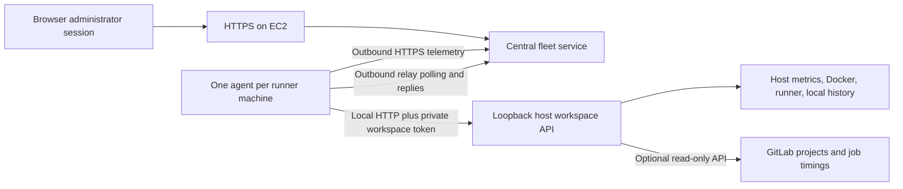
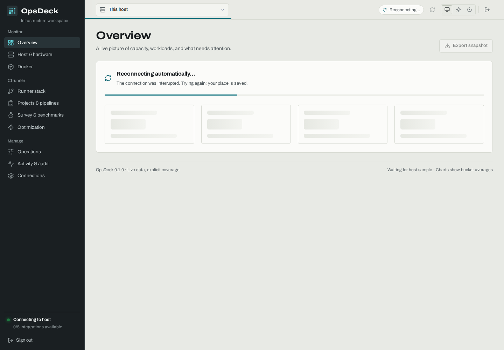
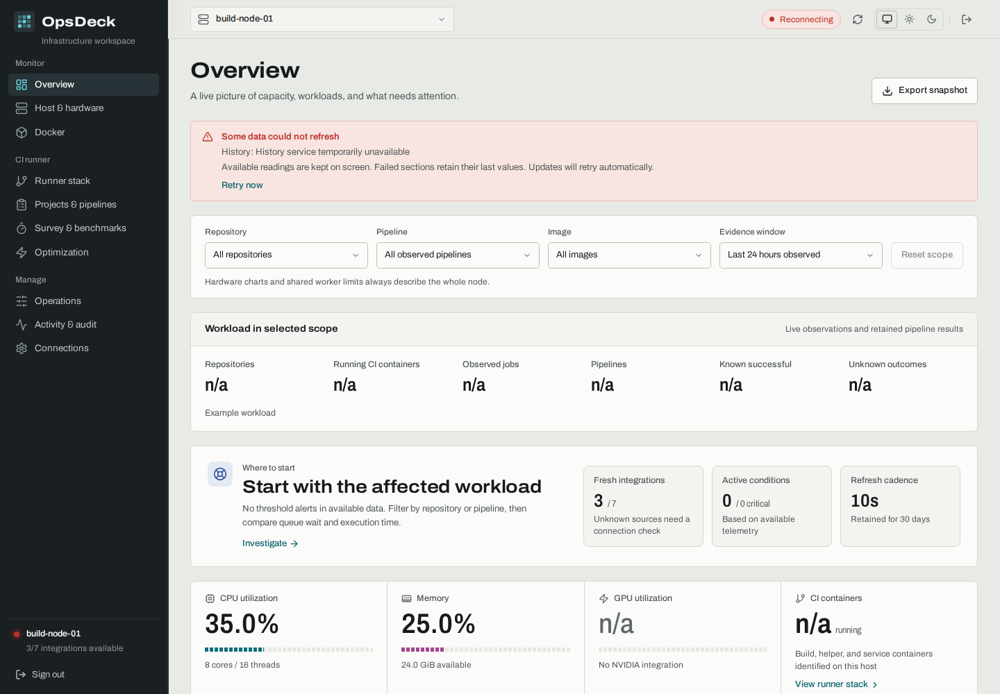

# OpsDeck: every page and how to investigate a slowdown

A practical guide to every page, source coverage, safe operations, and repeatable performance investigations. For exact fields and thresholds, see the [user guide](user-guide.md). Machine assessments and their internal screenshots belong in private operations records.

## 1. Sign in and understand the two connections

Open your deployment’s HTTPS URL. On a central server with an administrator account configured, use its username and password. A successful login creates a 12-hour browser session; Sign out revokes it. Individual accounts and roles are not implemented. Servers without an administrator account and standalone nodes use their configured access token.

The browser does not need the machine credentials. The deployed architecture is:

**Online agent** means recent telemetry reached the server. **Connected workspace** means the separate relay is available to serve full host pages. An online host can still have a disconnected full workspace.

There are separate credentials for separate purposes:

| Credential | Who uses it | Where it belongs |
|---|---|---|
| Administrator password | Person signing in | Password manager; salted hash on the central data volume |
| Browser session | Current browser tab | Issued by login; only its hash is retained server-side |
| Central `OPSDECK_TOKEN` | Private API/recovery clients | Central private environment; never returned by password login |
| `OPSDECK_AGENT_TOKEN` | One enrolled machine | That machine's `.env.agent`; unique per fleet identity |
| `OPSDECK_WORKSPACE_TOKEN` | Agent accessing its local API | That host's `.env.agent`; matches its local `OPSDECK_TOKEN` |
| Optional GitLab read-only token | Host API fetching project/job facts | Saved server-side through Connections or private integration settings |

Centralization changes where people sign in. It does not remove authentication between machines and services.

## 2. Host selector, scopes, freshness, and units

### Loading and recovering a connection

The initial host view shows an indeterminate progress strip, spinner, and placeholder readings while real observations arrive. It does not display invented percentages or empty measurements as if collection had finished. The thin top-bar strip and **Updating…** indicator show background refreshes without replacing the readings you are inspecting.

Safe GET requests automatically retry temporary network failures and HTTP 408, 429, 500, 502, 503, and 504 responses up to three attempts, with a short backoff. Retry-After is honored within a bounded delay. Each read has a 50-second deadline so the host relay can return its own timeout first. Authentication, permission, and validation failures are not automatically retried. Leaving a page cancels its reads and retry waits.

Host polling waits for the previous cycle to finish, pauses while the tab is hidden, resumes when it becomes visible or the browser reconnects, and backs off after failed cycles. A failed history or activity request does not discard a successful host reading. Available data stays visible; failed sections retain their previous values and a notice identifies the problem. **Retry now** starts a fresh cycle when the current one has finished. If the full host workspace cannot connect, **Agent access** remains available for retained observations.

These two images use synthetic example data. Real machine screenshots belong to private assessments. Read retries do not replay sign-in, enrollment, settings changes, uploads, previews, or operations. A lost response to a change has an unknown outcome: check current state and audit before submitting it again.

Use the top host selector to choose the machine you want to inspect. **All hosts** returns to the central fleet. The selected machine/section appear in the URL and survive reloads. Confirm the machine before interpreting any value or opening an operation.

- Hardware graphs describe the **whole selected machine**.
- Repository, pipeline, image, and evidence-window selectors narrow workload observations. They do not partition host CPU or change shared runner limits.
- The Overview **History range** changes the resource-history window. This is different from the workload **Evidence window**.
- Healthy collection does not mean the service or workload being observed is healthy. For example, a healthy service collector can report a failed systemd service.
- `n/a`, unknown, unavailable, and missing points are not zero. Check Connections before interpreting an apparently quiet dashboard.
- Docker CPU can exceed 100%: about 100% is one logical CPU equivalent. Whole-host CPU is normalized across the host.
- A job slot, a runner registration, a build container, and a helper container are different things. Two containers do not necessarily mean two concurrently scheduled jobs.
- Resource charts show bucket means. Retained peaks and sample counts give context; averages can hide short bursts.
- The normal workspace refresh interval is 10 seconds; different collectors refresh on different schedules. Image/cache disk usage is cached for about five minutes. GitLab polling is about once per minute when enabled.

## 3. All hosts: choose where to investigate

Read connection state and last contact first. Then compare CPU, memory, running CI containers, alerts, and history. Fleet averages cover reporting online hosts; they are not a guarantee that every integration on every host is working.

Use cluster/search/status filters to find the affected machine. Pulse cells show historical resource buckets, with missing samples distinct from idle. Use the longer history to locate the interval corresponding to the slow job.

An idle latest sample must be reconciled with earlier busy intervals. The central server is not automatically enrolled as a monitored host.

## 4. Enroll host: add a machine identity

Enter the actual runner machine name and its cluster/network, then create and save its one-time credential. This only creates a fleet identity; it does not install software, register a GitLab runner, or connect a full workspace.

Do this once per physical/virtual runner machine, not once per runner registration. Follow the complete [machine and runner enrollment guide](../operations/adding-machines.md).

## 5. Agent access: retained observations and identity management

This is the fallback when the live workspace is disconnected. It retains received host/container/runner observations and history. Check timestamps and source status rather than assuming retained values are current.

Host settings can name/move a host, add notes, set maintenance, and specify monitored collectors. Maintenance silences that host's fleet alerts without stopping its jobs or hiding its actual connection state. Marking a collector as unmonitored changes alerting; it does not install or repair it.

Rotation/revocation changes machine access. Rotation requires putting the new credential in that same host's private agent file and restarting/recreating its agent. Never copy its identity or spool to another machine. These are deliberate administrative actions; they are not routine refresh buttons.

## 6. Overview: first triage

Read the page in this order:

1. **Needs attention / Where to start:** current threshold and source conditions.
2. **Integration coverage:** establish which measurements are actually available.
3. **Capacity over time:** select the time interval that includes the slowdown.
4. **Resource diagnostics:** compare averages, retained peaks, and sample counts.
5. **Storage headroom / Filesystem risk ranking:** check both free bytes and inodes.
6. **Network throughput / CI queue history:** investigate trends, with the source-coverage caveat.

A filesystem warning is capacity evidence, not proof that disk fullness caused a particular slow job. A missing pressure graph is not a zero. A requested history window can exceed the history actually retained; check sample counts and timestamps.

Use **Export snapshot** to keep source state at a useful point. It records an observation, not a synthetic performance test.

## 7. Host & hardware: identify the constrained resource

Inspect CPU cores/threads, utilization/load, memory availability, swap, filesystems, disk latency/throughput/IOPS/busy time, network, temperature/GPU, services, and top processes.

| Pattern | Likely direction to investigate | Next check |
|---|---|---|
| High CPU during slow execution | CPU contention or CPU-heavy code | Job-internal worker count, nested parallelism, CPU quotas, frequency/thermal behavior |
| Low CPU while a job waits | Scheduling, I/O, network, locks, serial dependency, or missing job eligibility | Queue versus execution timestamps, I/O metrics, relevant process state and logs |
| Little available RAM, swap activity, memory PSI | Memory contention | Per-job RSS/limits, worker fan-out, cache versus application working set |
| I/O PSI and disk latency rise together | Storage contention | Which job paths/device are involved; simultaneous readers/writers |
| Filesystem bytes/inodes near limits | Capacity risk | Exact mount, retention, large directories, deleted-but-open files |
| Low daily average but high peaks | Bursty demand | Time-align spikes with job overlap; do not tune from the average alone |

None of these patterns uniquely identifies a root cause. Correlate more than one signal. `await` from a small I/O sample and NVMe busy percentage alone are not universal saturation tests. The process list is bounded and is not a full process profiler or command-line trace.

## 8. Docker: resource attribution and storage

Search the affected container and sort by CPU/RAM. Inspect state and Docker health separately from application success. Check the reported Docker data root and image/build-cache information.

For example, a build container around 1,600% CPU uses roughly 16 logical CPU equivalents. That is evidence of job-internal parallelism; it does not mean the host used 1,600% of its total capacity.

Image aliases share layers, so adding displayed image sizes double-counts space. Unreferenced volumes can still contain retained data. OpsDeck does not automatically prune Docker. Pruning Docker on a separate mount does not directly solve root-filesystem capacity.

## 9. Runner stack: scheduling versus actual workers

Look at these separately:

- **Runner service:** is the configured systemd service active?
- **Metrics endpoint:** can OpsDeck reach the loopback exporter?
- **Global/shared job limit:** maximum jobs across registrations in that runner process.
- **Registration limit:** a per-registration job cap; zero means sharing the global allowance.
- **Request concurrency:** job-request concurrency, not the number of compiler threads or job slots.
- **Running/retained workers:** Docker observations; shell jobs are not counted as Docker workers.
- **Images/cache:** local toolchains and backing storage.

A host limited to one job and a host already allowing sixteen jobs need different experiments. Configuration exports have dates; refresh them after changes. The operations helper, when available, returns a fresh revision-checked state.

Counters are cumulative. Aggregated histogram buckets in the collected metrics are not p95 durations. Missing GitLab queue measurements cannot be reconstructed by reading the runner's error counter.

## 10. Projects & pipelines: determine where time goes

Choose the affected repository, pipeline, image, and evidence window. Compare queue wait with job execution. Rank long jobs; inspect successful/failed/unknown outcomes and sample size.

Without a live GitLab integration, timing and success/failure coverage remains incomplete. Locally observed jobs/images can still populate workload tables, but cannot prove all pipeline outcomes. Unknown outcomes are neither passes nor failures. Some GitLab results can describe jobs executed on other hosts; use runner assignment to attribute them.

When configured, diagnose one of these first:

- **Long queue, normal execution:** registration/tag eligibility, protected jobs, runner pickup, shared/per-registration limits, or competing projects.
- **Short queue, long execution:** CPU, storage, dependency download, cache misses, test topology, or serial work.
- **Both long:** investigate scheduling and execution separately; a faster compiler stage may not improve total delivery if it waits longer to start.

## 11. Survey & benchmarks: retain comparable evidence

Use **Live survey checkpoints** to save a named baseline and a named result using the same scope. Include commit, image revision, job limits, compile/test workers, cache state, competing workload, and run IDs in the notes. Checkpoints save current observations; they do not start CI or time a benchmark automatically.

Run the actual workload through GitLab or the project's approved benchmark procedure. Compare execution, queue wait, throughput, failures, and retained resource peaks across repeated runs. Keep warm-cache and cold-cache results separate.

Imported surveys have their own dates and scope. Measured runs, cancelled runs, and projected completion are different types of evidence. Do not transfer one machine’s measured speedup to another machine without measuring it.

## 12. Optimization: hypotheses with evidence

Each card provides an observation and a possible next check. **Opportunity** does not mean applied tuning or proven savings.

For this estate:

- Verify storage paths before accepting generic NVMe suggestions: Docker is already on NVMe on both assessed runner hosts.
- Do not jump from a shared limit of 1 to 16 because the card mentions a high-slot benchmark. Establish per-job budgets first.
- Do not increase an existing shared limit of 16 simply because RAM is mostly free. CPU demand and per-job worker counts are the stronger current clues.
- Trial RAM scratch only for suitable disposable data with a measured memory ceiling and correct mount/execution semantics. Executable scratch files need suitable mount permissions; a noexec mount can break validation.
- Low average GPU utilization does not establish a useful GPU workload or authorize colocating conflicting GPU consumers.

## 13. Operations: supported changes and their prerequisites

| Operation | Inside OpsDeck | Outside prerequisites / limits |
|---|---|---|
| Shared/per-registration runner limits | Preview, review before/after, type exact confirmation, execute, inspect audit | Narrow host helper installed and connected; explicit operations enablement; global UI/helper range 1–32 |
| Load saved image | Upload a `docker save` archive, review, confirm, inspect result | Archive prepared on the source computer; disk headroom on target; fresh tags to avoid collisions |
| Build image | Upload a context or select an installed profile; choose a new local tag; review and confirm | Correct context/Dockerfile/dependencies; server-side build profiles for preinstalled checkouts |
| Tag local image | Select exact image ID and new local tag | This is a local alias, not a registry push; runner pull policy still matters |
| Stop/restart managed non-CI containers | Separate opt-in action workflow when enabled | `OPSDECK_ACTIONS=true`, managed labels, current-state checks; CI and OpsDeck containers are excluded |

Inspect the current capabilities: some hosts have Operations disabled, while others have an installed helper and build profiles. Do not mistake a displayed default form value for the current host limit; use live facts and the preview.

After submitting a mutation, a timeout can mean **unknown outcome**. Inspect local state and Activity before retrying. Image builds/imports are not automatically replayed. Review both runner registrations: changing the shared limit affects all users of that process.

Enable controls through the separate installation step in the [enrollment guide](../operations/adding-machines.md#optional-enable-reviewed-operations). Merely opening this page does not enable them.

## 14. Activity & audit and Fleet audit

Use host **Activity & audit** for threshold transitions and host action outcomes. Use central **Fleet audit** for enrollment, credential, maintenance/settings, and central workspace-operation records. These are different histories.

An alert that cleared remains evidence of a past event. An older I/O alert does not establish that the latest window was storage-bound. Check whether the current condition remains active.

## 15. Connections: establish coverage before claiming health

Check each source's state, message, update time, and scope. For the selected machine, configure **GitLab pipeline results** with the HTTPS GitLab origin, a dedicated read-only integration token with project access, and the relevant project IDs or namespace paths. Save, wait for polling, then confirm it becomes healthy and returns real jobs/timings. An empty form or a configured-token flag is not a successful connection test.

Each host has independent source coverage. A GPU may be absent, its tools may be missing, or its collector may be unavailable; use the source message to distinguish these cases. Connections reports configured credentials without returning their secret values.

## A repeatable optimization experiment

1. Select the affected machine and a real workload; confirm source coverage.
2. Record one unchanged baseline over several comparable runs. Use the same commit and image revisions.
3. Capture queue and execution separately, throughput, success rate, CPU peaks, memory, disk behavior, and cache hit statistics.
4. Change one variable: shared limit, per-job parallelism, cache configuration, or a verified storage path.
5. Repeat the same workload mix. Check other projects on the shared machine too.
6. Keep the change only if the chosen delivery metric improves without unacceptable regressions. Save the result and exact settings; restore the prior candidate if it regresses.

Do not declare an end-to-end speedup from idle CPU, an isolated cache hit rate, one bucket average, or an imported projection.
