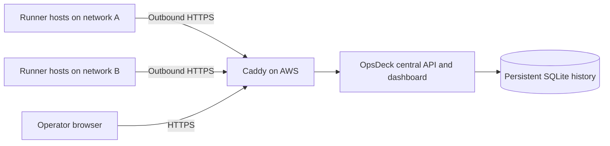

# Central server and runner agents

The central sidebar retains the original host workspace: Overview, Host & hardware, Docker, Runner stack, Projects & pipelines, Survey & benchmarks, Optimization, Operations, Activity & audit, and Connections. Choose a host in the top bar to use its workspace. With several hosts, clicking a section asks you to choose a host rather than guessing. Host and section survive reloads. **All hosts** returns to the fleet; **Agent access** opens retained observations and credential management. **Fleet audit** records central activity separately from the host's audit.

To connect the complete workspace, keep the existing standalone OpsDeck service on each host and add two settings to its agent's private environment:

- `OPSDECK_WORKSPACE_URL`: the existing host API's HTTP origin, for example `http://127.0.0.1:8080`. A literal IP address assigned to the host is also accepted when the service binds to that interface.
- `OPSDECK_WORKSPACE_TOKEN`: that existing host API's access token. It remains in the runner's private agent environment, separate from the fleet operator token and the per-host agent credential.

Restart the agent. It opens outbound HTTPS requests to claim work and stream replies; no agent listening port or inbound cluster connectivity is required. The original API supplies the same findings, checkpoints, worker history, GitLab connection, operation jobs, and permission checks. Existing preview, confirmation, and action-disable settings still apply. Read-only central deployments never execute host operations themselves.

Relay paths are an explicit GET/POST allowlist. Requests are bound to a node credential, cancelled on credential changes, limited to eight outstanding requests per host and 32 globally, and never replayed. A timeout after submission has an unknown outcome: inspect host activity before retrying a change. JSON requests are capped at 1 MiB and replies at 8 MiB. Archive uploads stream through private temporary storage on the fleet data volume, with one transfer at a time, the configured `OPSDECK_IMAGE_UPLOAD_MAX_GIB` limit, and at least 2 GiB free space. Temporary bodies are deleted after completion or cancellation. Run a single central application worker; the relay is intentionally process-local. A disconnected workspace shows a connection error while **Agent access** keeps its last telemetry available.


OpsDeck can run as a central fleet dashboard on an AWS instance while one outbound agent collects telemetry on each runner host. Each host belongs to a named cluster or network. A host with several GitLab runners needs only one agent.

Use the host selector in the top bar to switch between any enrolled hosts or **All hosts**. Hosts are grouped by cluster, and their connection states stay visible, including stale, offline, and revoked hosts. Selecting a host opens its own observations and history. The selected host is included in the URL, so refresh and browser back/forward preserve navigation. Choosing **All hosts** clears host, cluster, search, and status filters.

Standalone dashboards show their local hostname in the same selector. Set `OPSDECK_FLEET_URL=https://your-fleet.example.com` in that dashboard's environment and restart it to enable **All hosts (open fleet)**. This navigates to the central dashboard, where its own operator login applies. Local access tokens are never sent to the fleet origin. Standalone instances do not enumerate remote hosts themselves.



Agents do not listen for inbound connections. Each runner network must be able to reach the server's HTTPS origin, directly or through its approved outbound proxy. Fully isolated networks need routing or an approved relay established first. OpsDeck does not currently implement a cluster-local aggregation gateway.

## Start the AWS server

Install Docker Engine, Compose 2.30+, GNU Make, and Python 3.12+ on the instance. Clone the repository, then:

```bash
make init
```

Set `OPSDECK_DOMAIN=opsdeck.example.com` in the private `.env` file. Point that hostname's DNS record to the instance's stable public address. Make TCP ports 80 and 443 reachable for the public Caddy certificate flow, and allow outbound access for certificate issuance. Then:

```bash
make central-https-up
```

Open `https://opsdeck.example.com` and sign in with `OPSDECK_TOKEN` from the server's `.env`. The API's diagnostic port 8080 remains bound to loopback by default. Keep `OPSDECK_PUBLISH_IP=127.0.0.1`. Avoid combining the central override with host, GPU, control, or image-build overrides.

The central container has only its persistent application volume. It never starts local collectors or host controls. Caddy retains certificates in a separate volume and renews them automatically. See [Caddy's HTTPS requirements](https://caddyserver.com/docs/automatic-https) for private DNS and corporate TLS deployments. An existing HTTPS reverse proxy can front `make central-up` instead.

If the instance already runs Traefik, set `OPSDECK_DOMAIN` and `OPSDECK_PROXY_NETWORK` to its hostname and existing Docker network, then add `deploy/docker/compose.traefik.yaml` after the base and central overrides. Set `OPSDECK_PORT` to a free loopback port. `OPSDECK_IMAGE` optionally selects a release image, and `OPSDECK_TRAEFIK_ENTRYPOINT` / `OPSDECK_TRAEFIK_RESOLVER` default to `websecure` / `letsencrypt`. This adds only the new application's route; do not start the Caddy HTTPS profile or restart the existing proxy.

```bash
docker compose --project-directory . -p opsdeck-fleet \
  -f deploy/docker/compose.yaml \
  -f deploy/docker/compose.central.yaml \
  -f deploy/docker/compose.traefik.yaml up -d --build --wait
```

For native local development after `make setup`:

```bash
make central
```

This binds to `http://127.0.0.1:8080` by default. HTTP agent delivery is accepted only for loopback development URLs. Browser and agent origins must be served at `/`, without a URL path prefix.

## Enroll each runner host

1. Open **Enroll host** in the central dashboard.
2. Enter a host name and its cluster/network name.
3. Save the credential shown once. It belongs to this host only.
4. On that runner host, create a private `.env.agent` using the displayed server URL and credential. The full template is [`.env.agent.example`](../../.env.agent.example).

Install just the backend dependencies on a native runner; Node.js and a frontend build are unnecessary:

```bash
python3 -m venv .venv
.venv/bin/python -m pip install -r backend/requirements.lock
chmod 600 .env.agent
make agent
```

To install a persistent Linux user service:

```bash
make agent-install
make agent-status
make agent-logs
```

An administrator can enable boot persistence with `loginctl enable-linger <service-user>`. The service needs readable procfs and the intended host permissions. Docker telemetry requires intentional access to the Docker socket; native NVIDIA telemetry requires `nvidia-smi`. Runner metrics remain on the host's loopback listener. Exported runner facts omit runner credentials. Missing sources are displayed explicitly.

Alternatively, on Linux with Docker:

```bash
make docker-agent-up
```

This combines the existing host mounts and PID/network visibility with the agent command. It opens no application listener, disables the API health check, and stores its queue in the persistent `opsdeck_data` volume. Stop it with `make docker-down`, retaining the volume. Do not run a standalone container and agent container under the same Compose project at the same time. To add NVIDIA container access, combine the base, host, agent, and GPU overrides, in that order, with the host's NVIDIA Container Toolkit configured.

## Configuration and connectivity

| Variable | Where | Default / purpose |
|---|---|---|
| `OPSDECK_MODE` | Server | `standalone`; set `central` to receive agents |
| `OPSDECK_DOMAIN` | HTTPS Compose profile | `localhost`; production DNS hostname |
| `OPSDECK_TOKEN` | Server/operator browser | Random operator credential, at least 32 characters |
| `OPSDECK_SERVER_URL` | Agent | HTTPS origin of the central server |
| `OPSDECK_AGENT_TOKEN` | Agent | Per-host credential issued at enrollment |
| `OPSDECK_AGENT_SPOOL` | Agent | `./data/agent.sqlite`; `/data/agent.sqlite` in Compose |
| `OPSDECK_SAMPLE_SECONDS` | Server and agents | `10`; agent accepts 5..300 seconds |
| `OPSDECK_AGENT_QUEUE_SAMPLES` | Agent | `360` snapshots, maximum 10000 |
| `OPSDECK_AGENT_QUEUE_MIB` | Agent | `64` MiB of queued payloads, maximum 1024 |
| `OPSDECK_RETENTION_DAYS` | Server | `30`; retained numeric history and latest inventory |
| `SSL_CERT_FILE` | Agent | Optional trusted corporate CA bundle |
| `HTTPS_PROXY`, `NO_PROXY` | Agent | HTTPX outbound proxy configuration |

Use the same sample interval on the server and agents so freshness thresholds match. Existing host, runner, service-export, and Docker collector configuration applies on agents. Credentials for GitLab pipeline integration and private benchmark archives are not sent by agents. Fleet mode currently displays host resources, Docker/CI workers, images/cache, GPU, runner metrics/facts, and services.

The agent uses [HTTPX certificate verification](https://www.python-httpx.org/advanced/ssl/) and does not follow redirects. It sends no credentials to a redirect destination. Keep the server URL pointed at the final HTTPS origin. No insecure TLS bypass is provided.

## Outages and freshness

Every snapshot has a UUID and collection timestamp. The retry queue survives agent restarts and retains data until the server explicitly acknowledges it. It retries with exponential backoff and jitter, capped at approximately 60 seconds. Current health is delivered before older history when connectivity returns. Duplicate deliveries do not duplicate history, and old samples cannot replace the latest snapshot.

The queue drops oldest samples once either payload-byte or count limits are reached, with a warning in agent logs. Default capacity is up to one hour at 10-second sampling, subject to the 64 MiB payload bound. SQLite file overhead is additional. Snapshots over 2 MiB are dropped with a warning. HTTP 413/422 responses discard an invalid/expired snapshot; authentication failures and server/network failures retain it for retry. Keep host clocks synchronized; samples over 60 seconds ahead of server time or older than retention are rejected.

The dashboard distinguishes:

- **Waiting:** enrolled, but the current credential has not connected yet.
- **Online:** current connection and a recent observation.
- **Stale:** the agent contacted the server but its latest observation is old.
- **Offline:** no contact for `max(90 seconds, 6 × sample interval)`.
- **Revoked:** explicitly disconnected by an operator.

An observation becomes stale after `max(45 seconds, 3 × sample interval)`. Each integration also carries its own timestamp; a host's online status does not imply every collector is healthy. Service-file exports retain their existing 120-second freshness allowance. Histories show averaged buckets and retained peaks, with at most about 600 points per requested window. Older snapshots and history are pruned every minute, including inactive/revoked nodes; enrollment metadata and access audit records remain.

## Credentials, backup, and limits

Agent credentials can write telemetry and claim/respond to workspace requests for their server-assigned host ID. They cannot read fleet data, enroll nodes, or access another host's requests. Host workspace access additionally requires its private local token and preserves the host's operation permissions. The server stores SHA-256 hashes rather than recoverable agent credentials. Type the host name in **Agent access** to rotate or revoke its credential. Rotation invalidates the previous credential immediately and reconnects the same host identity after updating `.env.agent` and restarting the service.

Never reuse one host's credential on another host or copy its queue to another identity. Stop the service before replacing a host enrollment; archive/remove its old queue deliberately before starting with a new node ID. For credential rotation on the same host ID, retain the queue.

Back up the central database with `make docker-backup`, including enrolled identities, credential hashes, latest observations, history, and access audit records. Protect the backup like the dashboard. Restore the SQLite backup using the existing [maintenance procedure](maintenance.md). Keep `.env` and Caddy certificate volumes in your instance backup plan separately.

This release uses a single server process and SQLite on local persistent storage. It caps enrollment at 1000 identities as a guardrail; this is not a tested capacity claim. Size retention, storage, and agent frequency for your actual fleet. It has one operator credential, with no individual accounts or RBAC. Arbitrary remote shell commands, cross-host GitLab aggregation and benchmark comparisons, cluster-local gateways, Kubernetes API collection, and DaemonSet packaging are not implemented. Connected host workspaces retain their existing integration, survey, and operator workflows. Existing standalone databases are not automatically merged into fleet history.
