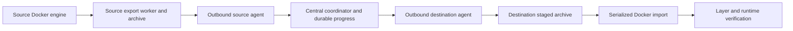

# Operator actions and local images

Open **Operations** to change runner capacity, load saved Docker images, build images on the node, or add a local image tag. Each operation has a preview, an exact typed confirmation, and an audit event. These actions use the Docker daemon on the monitored machine; a name containing a registry hostname is still a local tag. They do not publish an image to a remote registry.

## Enable controls

Set `OPSDECK_OPERATIONS=true` in the instance's private `.env`, then recreate the app with its existing Compose overrides. This is separate from `OPSDECK_ACTIONS`, which controls stop/restart of explicitly managed non-CI containers. Operators holding the instance access token can perform enabled operations.

Image operations require access to the node's Docker socket. Portable deployments without that socket can still show the forms, but Docker validation will report that the engine is unavailable.

## Change the number of workers

The **Shared job limit** is the maximum number of simultaneous jobs across all registrations in the runner's configuration. It is not the number of build and helper containers. Set it between 1 and 32. Optionally select one registration to change its job limit (0 means share the global limit) and request concurrency (1–8). CPU/RAM quotas and registration tokens are preserved.

On a Linux node using `/etc/gitlab-runner/config.toml`, install the narrow capacity helper from the deployed checkout:

```bash
sudo bash deploy/native/install-runner-control.sh
getent group opsdeck-control | cut -d: -f3
```

Set `OPSDECK_CONTROL_GID` in `.env` to the returned group ID and add `deploy/docker/compose.control.yaml` **last** in the existing Compose command:

```bash
export OPSDECK_DOCKER_GID="$(stat -c '%g' /var/run/docker.sock)"
docker compose --project-directory . \
  -f deploy/docker/compose.yaml \
  -f deploy/docker/compose.host.yaml \
  -f deploy/docker/compose.control.yaml \
  up -d --no-build --wait
```

Keep any GPU, services, or build-context overrides used by that installation before the control override. Native installations instead set `OPSDECK_RUNNER_CONTROL_SOCKET=/run/opsdeck-control/runner.sock` and give the app's service account membership in `opsdeck-control`; restart the app after changing group membership.

The installer copies the helper into root-owned `/opt/opsdeck-runner-control`, installs a boot-enabled systemd service and a group-restricted Unix socket, and writes sanitized facts to `/var/lib/opsdeck-control/runner-facts.json`. The app receives no write mount for the runner configuration. The helper supports only read, preview, and apply of scheduling settings. It validates a configuration revision at execution, uses the same maintenance lock as the tuning script, and creates a private backup before an atomic update. Refresh and review again if maintenance is active or another administrator changed the configuration.

Capacity changes use the runner's automatic configuration reload; they do not restart the service. Lowering capacity allows current jobs to finish before additional jobs are accepted. See [GitLab's configuration documentation](https://docs.gitlab.com/runner/configuration/advanced-configuration/).

## Prepare an image for a failed job

In the selected host's **Operations** page, enter the job's exact image tag including its version (for an unqualified job image such as `team-toolchain`, use `team-toolchain:latest`). **Check runner readiness** reports whether this tag exists in the workspace's Docker engine, CPU architectures, archive staging space, Docker disk free space when accessible, and runner image policies. An engine running in a VM may not report its disk's free space; archive staging space is separate and does not prove that the VM has room.

If the tag is missing, import a saved image, build from a Dockerfile/context, or select **Copy from another host** in fleet mode. Choose a source host and its inventory tag, review both staging budgets and architectures, then confirm the exact copy. Operations must be enabled on both hosts; both workspaces and agents must run this release. Different architectures require explicit confirmation that the destination supports emulation; copying does not install an emulator.

The background copy has separate export, copy, import, and verification stages. The source saves an archive of the reviewed image and checks its config against that image before making it available. Agents relay checksummed 4 MiB chunks through the fleet server; the central server never stages a whole image. The destination retains its byte offset and accepts identical repeated chunks without appending duplicates. Connectivity loss and central restarts resume the byte copy. Closing the browser does not stop it.



Before importing, the destination verifies the archive SHA-256 and refuses existing tags. It uses the same serialized image-operation worker as builds and browser uploads, so this workflow does not start overlapping imports. Verification compares all layer hashes and normalized runtime configuration, rather than assuming different Docker storage backends expose identical image IDs. Successful transfers remove their source export and destination upload. Failed/unknown results retain artifacts for inspection; **Discard staged archives** removes only these artifacts, preserving Docker images. An unavailable source can retain a successful transfer's export until explicit cleanup.

Host restarts during an export/import leave that mutation **unknown**, without automatically replaying it. Inspect the host's live images and operation history before starting a new copy. A disconnect during a chunk transfer is resumable; an unknown Docker mutation is not treated as safely repeatable. Transfer records live alongside the central SQLite database in `<OPSDECK_DB>.image-transfers`; include that database in backups.

When a locally built image exists but jobs still try Docker Hub, review the selected Docker registration's **Image pull policy**. **Use local image when present** sets `if-not-present`; **Always pull from registry** sets `always`. The helper validates the reviewed configuration revision, creates a private backup, changes only that registration's policy, and lets GitLab Runner reload without restarting jobs. Existing `allowed_pull_policies` restrictions are respected. Reusing cached private images is appropriate only for projects trusted to share that runner.

On macOS, install the helper as the user who owns GitLab Runner, using the workspace virtualenv:

```bash
.venv/bin/python deploy/native/install-runner-control-macos.py
```

Set the printed `OPSDECK_RUNNER_CONTROL_SOCKET` in the private workspace environment, set `OPSDECK_OPERATIONS=true`, and restart only OpsDeck. The helper uses a user LaunchAgent and local Unix socket. Linux retains the systemd helper installation described above; rerun its installer when upgrading helper code.

### Retry the failed job

Optional **Retry a failed GitLab job** uses a separate private `OPSDECK_GITLAB_RETRY_TOKEN` with `api` access on the host. Keep the existing monitoring token read-only. The project must be configured in the host's GitLab connection (or observed with auto-project discovery), and the job must currently be failed. Review shows its name, stage, and ref before typed confirmation. Retrying can execute any script in that job; it is always a separate action after image verification. A timed-out retry is never automatically replayed: inspect GitLab for a newer attempt.

## Load an image from a computer or USB drive

On the source machine, save an image:

```bash
docker save --output toolchain.tar example/toolchain:v3
# Optional compression:
gzip toolchain.tar
```

Copy the archive to USB if needed. In OpsDeck choose **Load saved image archive**, use the file picker to select the `.tar` or `.tar.gz` directly from your computer or attached USB drive, wait for the upload, then review and confirm **load image archive**. The browser uploads the file to the monitored node; the USB does not need to be mounted inside the app container.

The archive must be a `docker save` archive with a Docker manifest. `docker export` produces a container filesystem and is not accepted. The worker checks the archive's tags before import and refuses tags already present on the node. Retag and save the source image with a new revision to resolve a collision. It resolves every imported tag through Docker after the load and records the resulting image IDs.

A SHA-256 and byte count identify each uploaded file. Completed unused uploads remain selectable after a browser refresh and can be discarded. Successful imports/builds remove their staged archive; failed archives remain available. Unused staged archives older than 24 hours are cleaned when the next upload begins.

## Build on the monitored node

Choose **Build an image on this node**, then upload a build context archive:

```bash
# Run inside a minimal build context containing Dockerfile and required files.
tar -czf /tmp/image-context.tar.gz Dockerfile requirements.txt src/
```

Set the relative Dockerfile path and a **new local image tag**, then review and confirm. Exclude credentials, `.env`, and unnecessary files from the archive. Uploaded archives are sent as explicit contexts; the uploader does not apply `.dockerignore`. Contexts must contain regular files/directories with relative paths and no symbolic/hard links or device entries.

The current Docker SDK builder supports ordinary Dockerfiles, including the existing CI toolchain Dockerfile. BuildKit-specific features such as `RUN --mount` require a separate compatible build workflow. Builds keep intermediate-container cleanup enabled, use a 2 GiB build-container memory limit and low CPU shares, and share one serialized image-operation worker with imports/tags. Package downloads can still consume network and disk capacity.

For existing checkouts on the node, configure build profiles in a private JSON file:

```json
[
  {
    "id": "base-toolchain",
    "label": "Base toolchain",
    "path": "/build-contexts/project/scripts/ci/toolchain",
    "dockerfile": "Dockerfile",
    "buildargs": {
      "FROM_IMAGE": "ubuntu:24.04",
      "APT_PACKAGES": "cmake ninja-build g++",
      "SOURCE_REVISION": "reviewed-revision"
    }
  }
]
```

Use `deploy/docker/compose.builds.yaml` with `OPSDECK_BUILD_ROOT` pointing to the node's checkout directory and `OPSDECK_BUILD_PROFILES` pointing to that JSON file. It mounts both read-only. Native installations use actual absolute paths and `OPSDECK_BUILD_CONTEXTS_FILE`. Profile arguments stay server-side. Derive package sets and pins from the project's own CI/build definitions; refresh the private profile file when those definitions change. The existing toolchain build script's `--dry-run` output is useful for that review.

Profiles are revalidated before execution. Their source files are read when the queued build starts; a profile is not a frozen source checkout. Existing image tags are refused, so use a new revision suffix when package definitions change.

## Add a local alias

Choose **Add a local image tag**, select an exact image ID from the inventory, and enter a new tag. For example, assigning the exact tag named in a pipeline lets its runner resolve a locally loaded image. No network upload occurs. Whether a pipeline uses the local image also depends on its runner's image pull policy.

## Progress, results, and filters

Image operations run in the background, one at a time, with up to four waiting tasks. The page polls task state every five seconds. Successful images appear in the inventory on its next refresh (up to 30 seconds). Build progress includes step counts; raw Dockerfile output is not retained because builds can print credentials.

**Image operation history** filters by target/name and queued, running, successful, failed, or unknown result. An application restart marks interrupted operations **unknown** and never automatically repeats them; inspect the local image inventory before retrying. A timeout may leave work continuing in Docker. A failed task does not establish that Docker made no changes.

**Docker** filters by name/image/ID, state, and ownership, and sorts by name, CPU or memory. **Runner stack** filters live workers by project/job/image/name, state and role; history has separate search/state filters. Images filter by tag/ID, tag presence and container references, and sort by age, name or size. **Activity & audit** filters action/alert events and severity. Tables have pagination and reset controls. Filters affect the visible table; summary counts continue to describe the sampled node.

## Storage settings

| Setting | Default |
|---|---|
| `OPSDECK_OPERATIONS` | `false` |
| `OPSDECK_RUNNER_CONTROL_SOCKET` | empty, helper disconnected |
| `OPSDECK_IMAGE_UPLOAD_DIR` | `./data/image-uploads` native; `/data/image-uploads` Compose |
| `OPSDECK_IMAGE_UPLOAD_MAX_GIB` | `32`, range 1–128; aggregate staging allowance |
| `OPSDECK_IMAGE_OPERATION_TIMEOUT` | `7200` seconds, range 60–21600; Docker worker read timeout for large exports/imports/builds |
| `OPSDECK_BUILD_CONTEXTS_FILE` | empty, optional node profiles |

Staging enforces its aggregate size allowance and keeps at least 2 GiB free. Image layers and build outputs consume additional space in the Docker data root. Existing Docker images are never pruned by these actions. The last 50 task results are returned to the UI; up to 200 completed records are retained in SQLite, with durable action audit events retained separately.
